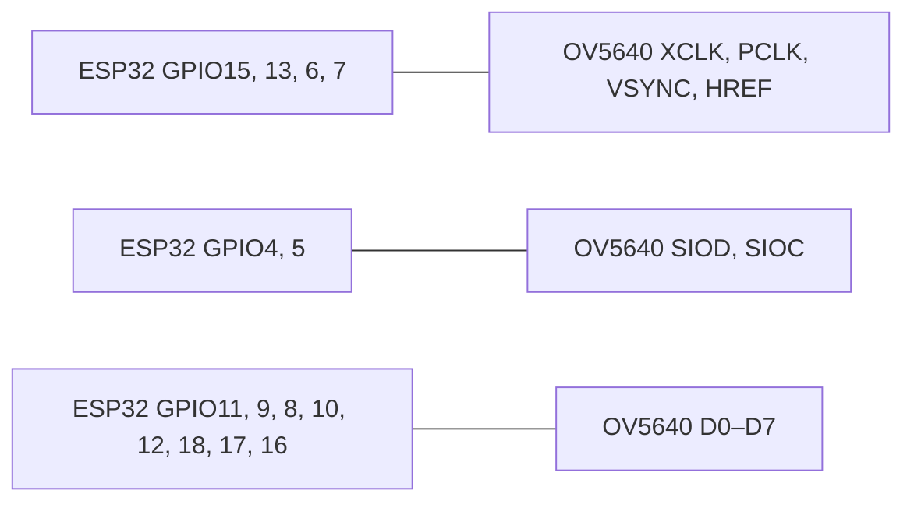
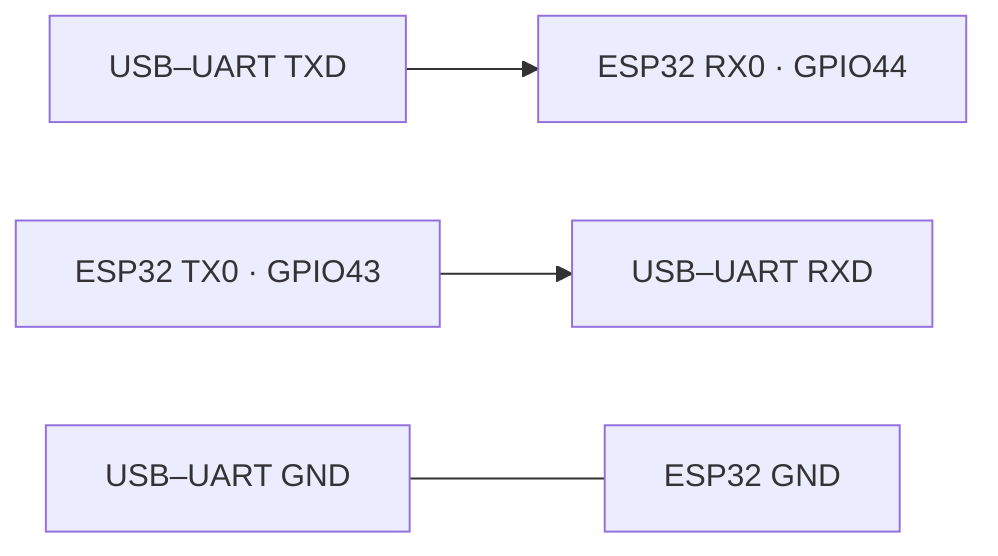

# DockyCam
LTS v1.1.1
v0.3.7 (Firmware v0.3.4 / LTS v1.1.1)

ESP32-S3(OV5640) 기반 무선 작업대 카메라·단독 SD 블랙박스·간이 클라우드 허브입니다. **집 공유기(STA) 연동**으로 인터넷을 유지한 채 Android 앱·PC 브라우저에서 `http://dockycam.local/`로 접속할 수 있으며, 공유기가 없거나 연결에 실패(12초 타임아웃)하면 자동으로 직결 Wi‑Fi AP(`DockyCam`, `192.168.4.1`)로 전환됩니다. 기본 해상도는 640×480이며 시청 시간 제한 없이 앱에서 정지하거나 연결이 끊기면 카메라를 대기 모드로 전환합니다.

카메라는 시청·녹화할 때만 시작합니다. 센서의 JPEG를 그대로 송출하고 XCLK 12MHz(저EMI 구동 강도 `GPIO_DRIVE_CAP_0`), PSRAM 더블 버퍼(`fb_count = 2`, `CAMERA_GRAB_LATEST`), CPU 160MHz, HTTP·카메라 Core 1 격리(`Core 0`은 Wi-Fi/LwIP 전용), `HT20` 및 Wi-Fi 모뎀 슬립 해제(`WIFI_PS_NONE`)로 구동합니다.
- **STA(공유기) 모드**: 송신 출력 `19.5dBm`, 멀티홉 지연을 줄이도록 JPEG 품질을 자동 튜닝(`HD 20 / 기타 16`)하며 부팅 시 한국 표준시(`KST-9`, NTP)를 자동 동기화합니다.
- **SoftAP(직결) 모드**: 부팅 시 주변 2.4GHz 채널(1/6/11)을 RSSI 가중 스캔해 가장 한산한 채널을 자동 선택하고 송신 출력 `17dBm`, JPEG 품질 `HD 16 / 기타 14`로 동작합니다.

전송용 프레임을 별도 PSRAM 버퍼로 복사한 뒤 드라이버 버퍼를 즉시 반환해 Wi-Fi 송신과 다음 프레임 캡처가 병렬로 진행됩니다. UART에서는 5초 주기 실시간 FPS·캡처·송신 로그와 세션 종료 통계를 확인할 수 있습니다.

## v0.1.6 실물 보드 · Android 실전 측정

장착된 OV5640과 ESP32-S3 N16R8에 Android 휴대폰을 직접 연결해 실시간 스트리밍 중 UART 송신 지연, 최대 스파이크, 칩 내부 온도를 비교 측정한 결과입니다.

| 구간 / 설정 | JPEG 크기 | 평균 캡처 | 평균 TCP 송신 | 최대 송신 | 실측 FPS | 칩 온도 |
| --- | ---: | ---: | ---: | ---: | ---: | ---: |
| 카메라 OFF (동일 19.5KB 순수 Wi-Fi) | 19.5 KB | — | 20 ms | 39 ms | 43+ fps | — |
| v0.1.3 / 20MHz (SVGA · HD) | 17 ~ 27 KB | 5 ~ 78 ms | 427 ~ 7,249 ms | 7,249 ms | 0.1 ~ 2.3 fps | 45.7°C |
| v0.1.4 (송신 중 OV5640 `0x3008` SW 대기) | #0 22.5 → 10.2 KB | 46 ms | 57 ~ 257 ms | 257 ms | 검정 화면 | 53.7°C |
| **v0.1.6 SVGA (800×600, XCLK 12MHz, Core 1, 빈 채널 HT20)** | **18.9 KB** | **118 ms** | **27 ms** | **105 ms** | **6.8 fps** | **45.7°C** |
| **v0.1.6 HD (1280×720, XCLK 12MHz, CPU 160MHz, Core 1, 빈 채널 HT20)** | **29.0 KB** | **90 ms** | **37 ms** | **83 ms** | **7.7 fps** | **46.7°C** |

`XCLK 20MHz`는 빈 채널과 Core 1 격리에서도 RF 간섭으로 3.7~7.2초 송신 정체가 발생하지만, `XCLK 12MHz 저EMI` + `Core 1 격리` + `빈 채널 HT20` + `CPU 160MHz` 조합에서는 **HD(1280×720)에서도 최대 송신 지연 83ms, 칩 온도 46.7°C**로 무중단 스트리밍이 유지됩니다. Android 앱도 시청 중 `WIFI_MODE_FULL_LOW_LATENCY` 잠금을 유지하며, **전체화면** 버튼으로 가로 풀화면 내부 플레이어로 바로 전환할 수 있습니다.

## 준비물

- ESP32-S3 N16R8 보드와 기존에 장착한 OV5640 카메라
- 보드의 USB UART 단자 또는 3.3V 로직 USB–UART 어댑터
- Android 10 이상 휴대폰

## 배선

전원을 끈 상태에서 신호와 전원 핀을 확인하세요. GME12864-11-12-13 배선 기록은 [v0.1.0 README](https://github.com/kjsu1994/esp32-s3-camera/blob/v0.1.0/README.md#oled-4핀)에 있습니다.

### 기존 카메라

이미 장착된 카메라는 그대로 사용합니다. 아래 표는 기존 보드 프로필의 **ESP32 GPIO 번호와 카메라 신호**를 연결합니다. 카메라 커넥터의 접점 번호, 전원 핀, 리본 방향은 보드 또는 모듈 회로도를 기준으로 확인합니다.

| 신호 | ESP32 GPIO | 신호 | ESP32 GPIO |
| --- | --- | --- | --- |
| XCLK | 15 | PCLK | 13 |
| SIOD / SCCB SDA | 4 | SIOC / SCCB SCL | 5 |
| VSYNC | 6 | HREF | 7 |
| D0 / Y2 | 11 | D1 / Y3 | 9 |
| D2 / Y4 | 8 | D3 / Y5 | 10 |
| D4 / Y6 | 12 | D5 / Y7 | 18 |
| D6 / Y8 | 17 | D7 / Y9 | 16 |
| PWDN | 미할당 | RESET | 미할당 |



[기존 OV5640 핀맵](https://github.com/kjsu1994/ESP32-S3/blob/master/include/boards/esp32s3_camera_ov5640.h), [이 프로젝트의 핀 정의](firmware/include/board_pins.h)

### 보드 내장 주변장치 (SD · RGB LED · BOOT 버튼)

| 기능 | ESP32 GPIO | 비고 |
| --- | :---: | --- |
| microSD (`SD_MMC` 1-bit) | 39 (CLK), 38 (CMD), 40 (D0) | 핫스왑 자동 재마운트 지원 |
| 상태 RGB LED (NeoPixel) | 48 | 설정에서 스텔스(완전 소등) 전환 가능 |
| `BOOT` 버튼 | 0 | 짧게 누름: 즉시 SD 스냅샷 / 5초 길게 누름: STA 초기화 후 AP 모드 재부팅 |

### UART 업로드

보드에 USB UART 단자가 있으면 해당 단자와 PC를 USB 케이블로 연결합니다. 외장 USB–UART를 쓸 경우 3.3V 로직의 TX/RX를 교차 연결하고 GND를 공유합니다. 보드에 별도로 전원을 공급하는 경우 어댑터의 전원 핀은 비워 둡니다.



자동 다운로드 진입이 되지 않으면 BOOT을 누른 채 RESET을 눌렀다 놓고 BOOT을 놓습니다. `COM9`는 초기 개발 PC에서 확인한 포트이며, 다른 PC에서는 장치 관리자에서 포트를 확인합니다. [Espressif 부트 모드 및 자동 리셋](https://docs.espressif.com/projects/esptool/en/latest/esp32s3/advanced-topics/boot-mode-selection.html)

## 펌웨어 올리기

PlatformIO를 설치하고, 예제 설정을 복사한 뒤 `CAMERA_AP_PASSWORD`에 8–63자의 고유한 ASCII 비밀번호를 입력합니다. 설정 파일은 Git에서 제외됩니다.

```powershell
Copy-Item firmware/include/config.example.h firmware/include/config.local.h
pio run -d firmware
pio run -d firmware -t upload --upload-port COM9
pio device monitor -d firmware --port COM9
```

UART 속도는 115200이며 초기 상태에서 `[Wi-Fi] DockyCam at 192.168.4.1` 및 `[mDNS] http://dockycam.local/`을 확인합니다. 첫 영상 요청 때 센서 PID `0x5640`과 PSRAM 용량이 출력되며, 종료하면 카메라 세션 정리 결과가 출력됩니다. 카메라와 전원부 표면 온도 및 XCLK 출력의 물리적 검증은 별도로 진행합니다.

## Android 앱 (v0.3.7)

1. GitHub [릴리스](https://github.com/kjsu1994/esp32-s3-camera/releases)에서 `esp32-s3-camera-v0.3.7.apk`를 받아 설치합니다.
2. **실시간** 탭에서 **연결 및 보기**를 누르면 연결 우선순위(`자동 (공유기 우선)` / `집 공유기` / `직결 AP`)에 따라 수동·최근 IP 및 mDNS(`dockycam.local`)로 먼저 탐색하고, 없을 경우 직결 AP(`DockyCam`)로 연결합니다.
3. 우측 상단 **설정(⚙)** 화면은 **4개 탭(`연결` · `카메라` · `저장소` · `기기`)** 으로 구분되어 있어 원하는 설정을 바로 찾을 수 있습니다. **연결** 탭에서 주변 2.4GHz 공유기를 선택해 저장하거나 **웹 주소 QR 열기**로 다른 기기에 웹 대시보드를 바로 공유할 수 있고, **기기** 탭에서 USB 연결 없이 `.bin` 파일을 선택해 **무선 펌웨어 업데이트(OTA)** 와 원격 재부팅을 실행할 수 있습니다. *(12초 연결 실패 시 자동 AP 폴백, 보드 `BOOT` 버튼 5초 길게 누르면 AP 초기화)*
4. 하단 4개 탭(**실시간 · 녹화 · 보관함 · 도구**)에서 다음 기능을 사용할 수 있습니다:
   - **실시간**: 두 손가락 핀치 줌(1×~5×)·드래그 이동·더블탭 확대, 정지화면(Freeze), 그리드·십자선, **실시간 라이브 뷰 HUD**(해상도·FPS·전송량·연결 상태, 보드 부하 0%, 원터치 토글), 시청 중 불필요한 상태 폴링 자동 일시정지, 사진 저장(`Pictures/DockyCam`), 가로 풀화면 내부 플레이어 전환, 시청 중 `WIFI_MODE_FULL_LOW_LATENCY` 잠금 유지.
   - **녹화**: 보드 microSD(`SD_MMC` 1-bit) 기반 **단독 블랙박스 순환 녹화**(1분/3분/5분 분할, 30초 주기 AVI 헤더 flush로 전원 차단 보호, 부팅 시 자동 녹화 옵션, 실시간 시청·파일 전송 시 자동 일시정지 후 복귀), **타임랩스 촬영**(1~60초 간격 → `.avi` 저장), **원터치 SD 스냅샷**(보드 `BOOT` 버튼 짧게 눌러도 저장).
   - **보관함**: 전체·공유함·블랙박스·타임랩스·스냅샷 파일 열람, **공유함 하위 폴더 이동(브레드크럼)·새 폴더 생성·이름 변경·검색·정렬(최신/이름/용량)·다중 선택 일괄 삭제·다중 파일 업로드**, **다른 앱에서 "공유 → DockyCam"** 으로 사진·파일·링크 즉시 전송(`ACTION_SEND`/`ACTION_SEND_MULTIPLE`), **로컬 QR 에어드롭**(모든 파일·웹 주소를 QR로 즉시 타 기기에 전송), **비차단 백그라운드 `.avi` → `.mp4`(H.264) 변환**(실시간 시청 유지, 갤러리 `Movies/DockyCam` 저장 & 카톡·SNS 바로 공유), **SD 영상 플레이어(타임라인 탐색 슬라이더·1프레임 스텝·배속·현재 프레임 갤러리 저장·일시정지 타임아웃 없음)**, 휴대폰 다운로드(`Downloads/DockyCam` / `Pictures/DockyCam`), **빠른 메모·링크 공유판**(최대 30개, URL 자동 링크·복사/수정/삭제, PC 웹과 실시간 동기화).
   - **도구 (하드웨어 네트워크 · 포트 테스터)**: 보드 미연결 상태에서도 Wi-Fi 및 USB-C 이더넷 직결 환경에서 단독 동작. **서브넷 장비 IP 자동 탐색**, **열린 TCP 포트·프로토콜·배너 스캔**(주요 제어 포트 29개 / `1~1024` / 사용자 지정 범위), **UDP(브로드캐스트)·TCP 실시간 수신 패킷 모니터**(송신 IP·포트·HEX/TEXT), **TCP·UDP 제어 테스트 콘솔**(TEXT/HEX 송신, `\n`/`\r\n` 끝문자 지원).

## PC · 모바일 내장 웹 대시보드 (`http://dockycam.local/`)

별도 프로그램 설치 없이 같은 네트워크의 PC·태블릿 브라우저에서 `http://dockycam.local/` 또는 보드 IP로 접속할 수 있습니다.
- **실시간 미리보기 & 보드 제어**: 브라우저 실시간 영상(시청 중 상태 폴링 자동 일시정지), PC 사진 저장, 전체화면, 해상도·180° 회전·저대역폭 설정, RGB LED 스텔스 전환, 원격 재부팅.
- **간이 클라우드 공유함 (`/dockycam/shared`)**: 드래그&드롭 다중 파일 업로드, **클립보드 스크린샷 `Ctrl+V` 즉시 업로드**, 하위 폴더 생성(최대 3단계)·이동(브레드크럼), 파일/폴더 이름 변경, 검색·정렬(최신/이름/용량), 체크박스 일괄 삭제, **브라우저 내장 미리보기(이미지·AVI·텍스트/코드)**. 공유함 파일은 블랙박스 순환 삭제에서 보호됩니다.
- **전송 집중 모드 (`TransferGuard`)**: 파일 업로드·다운로드 또는 OTA 중에는 실시간 영상과 SD 백그라운드 녹화를 자동으로 일시정지해 Wi-Fi·SD 전송 속도를 최대로 확보하고, 완료 후 녹화를 자동 재개합니다.
- **빠른 메모·링크 공유판**: `/dockycam/notes.json`에 최대 30개 메모를 저장하며(`Ctrl+Enter` 저장, URL 자동 링크), Android 앱과 실시간으로 주고받을 수 있습니다.
- **무선 펌웨어 업데이트 (OTA)**: USB 연결 없이 하단 OTA 카드에서 PlatformIO로 빌드한 `firmware.bin`을 업로드해 무선 업데이트(`0xE9` 이미지 헤더 검증, 실패 시 기존 펌웨어 유지, 성공 시 자동 재부팅)할 수 있습니다.

### 시각 동기화 & RGB 상태 LED (GPIO48)

- **시각 자동 동기화**: 집 공유기(STA) 연결 시 NTP(`pool.ntp.org`, `time.google.com`, `kr.pool.ntp.org`)로 한국 시각(`KST-9`)을 자동 동기화하며, 직결 AP 모드에서는 Android 앱이 `POST /time`으로 동기화해 녹화 파일명(`YYYYMMDD_HHMMSS`)과 메모 시각에 반영합니다.
- **RGB 상태 LED**: 대기(**초록**) · 실시간 시청(**파랑**) · 파일 전송/OTA(**하늘색 점멸**) · 블랙박스(**빨강 점멸**) · 타임랩스(**노랑 점멸**) · SD 오류(**빠른 빨강 점멸**) · 스텔스 모드(**완전 소등**).

### HTTP API 개요

포트 80에서 웹 UI 및 제어/파일 API(`/`, `/status`, `/telemetry`, `/settings`, `/stop`, `/time`, `/wifi/status`, `/wifi/scan`, `/wifi/config`, `/led`, `/reboot`, `/sd/status`, `/sd/record`, `/sd/snapshot`, `/sd/files`, `/sd/file`, `/sd/upload`, `/sd/mkdir`, `/sd/rename`, `/sd/notes`, `/sd/delete`, `/ota/upload`), 포트 81에서 MJPEG 스트림(`/stream`)을 제공합니다. 시청 중에는 화면이 절전으로 꺼지지 않으며, 앱을 백그라운드에 두면 약 2초 뒤 실시간 송출을 멈춥니다(단독 블랙박스·타임랩스 녹화는 보드에서 계속 유지됩니다).

### 앱에서 보드 제어

연결 상태에서 **설정 → 보드 설정**을 열면 다음 항목을 바꿀 수 있습니다. 설정은 보드에 저장되어 재부팅 후에도 유지됩니다.

| 설정 | 동작 |
| --- | --- |
| 영상 해상도 | 320×240, 640×480, 800×600, 1280×720 중 선택합니다. 일반 모드에서는 별도 지연 제한 없이 송출하며, 시청 중 설정을 저장하면 스트림을 재시작해 반영합니다. |
| 전송 절전 | 다음 시청의 상한을 6fps로 낮춰 Wi-Fi 전송량과 발열을 줄입니다. |
| 180° 회전 | 카메라 모듈에서 가로와 세로를 뒤집습니다. |
| 정지 | 앱의 정지 버튼이 보드에 종료를 요청합니다. 보드는 센서를 대기 모드로 전환하고 카메라 클록을 끕니다. |

보드는 `GET /settings`와 `POST /settings`를 통해 해상도와 촬영 옵션을 JSON으로 읽고 저장합니다. `POST /stop`은 진행 중인 촬영을 끝냅니다. 제어용 JSON POST는 `Content-Type: application/json`을 요구합니다.

### 온도 및 전력 표시 

앱의 **설정 → 온도·전력 표시**를 선택하면 보드에 연결된 동안 5초마다 상태를 갱신합니다. 메뉴에서 다시 숨길 수 있습니다. 온도는 ESP32-S3 칩 내부 센서 값입니다. 카메라 모듈의 표면 온도는 별도 온도계로 측정합니다. [Espressif 온도 센서 문서](https://docs.espressif.com/projects/esp-idf/en/stable/esp32s3/api-reference/peripherals/temp_sensor.html)

소비전력 실측은 선택 사항인 INA219 모듈이 필요합니다. 센서가 없거나 읽기 실패하면 앱에 센서 미연결을 표시합니다. 모듈을 장착하는 경우 전원을 끈 뒤 아래 표대로 연결하고, 카메라가 사용하지 않는 GPIO 쌍을 `config.local.h`의 `POWER_SDA_GPIO`와 `POWER_SCL_GPIO`에 지정합니다. 기본 I²C 주소는 `0x40`이고, `POWER_SHUNT_MILLIOHMS`는 모듈 션트 값과 일치시킵니다. R100 모듈은 기본값 100mΩ을 사용합니다.

| INA219 표기 | 연결 |
| --- | --- |
| VCC / GND | 보드 3V3 / 공통 GND |
| SDA / SCL | 확인한 별도 I²C GPIO 쌍 |
| VIN+ / VIN− | 5V 전원 양극 → VIN+ → VIN− → 보드 5V |

소비전력을 잴 때 보드 전원이 션트를 통해 공급되도록 구성합니다. 보드 USB VBUS로 동시에 전원을 공급하면 일부 전류가 센서를 우회합니다. [INA219 제조사 사양](https://www.ti.com/product/INA219)

### 앱 소스에서 빌드

JDK 17과 Android SDK 36이 필요합니다.

```powershell
Set-Location android
.\gradlew.bat testDebugUnitTest lintDebug assembleRelease
```

릴리스에 배포할 APK는 `app/build/outputs/apk/release/`의 unsigned APK를 `zipalign`한 뒤 `apksigner`로 서명합니다. 향후 같은 설치본을 업데이트하려면 최초 APK와 같은 서명 키로 서명합니다. [Android 앱 서명](https://developer.android.com/studio/publish/app-signing)
