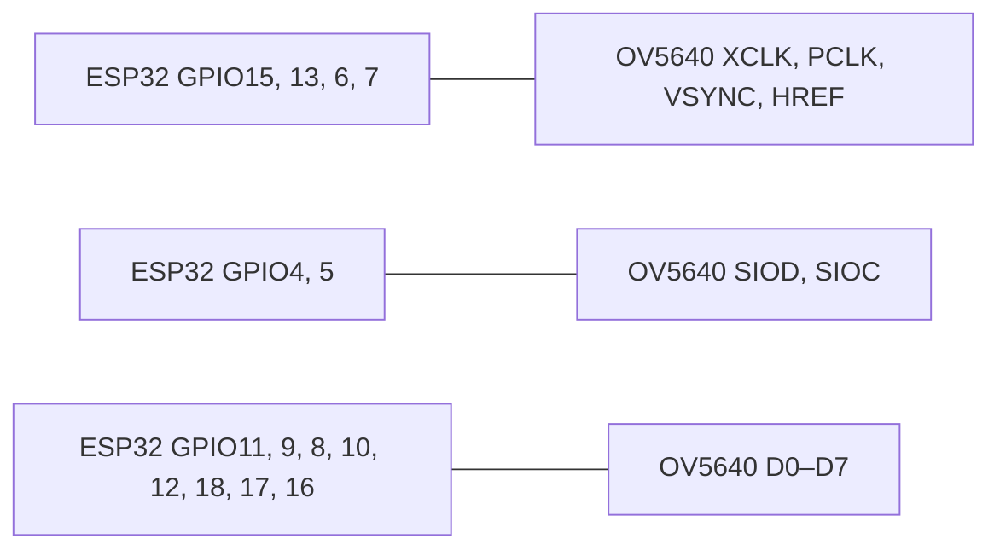
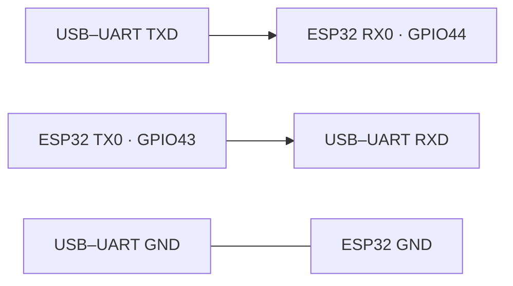

# WorkbenchCam

ESP32-S3가 만든 Wi‑Fi에 Android 휴대폰을 직접 연결해 작업대 영상을 보는 카메라입니다. 기본 해상도는 640×480입니다. 시청 시간 제한은 없으며 앱에서 정지하거나 연결이 끊기면 보드가 카메라를 대기 모드로 전환합니다.

카메라는 시청할 때만 시작합니다. 센서의 JPEG를 그대로 송출하고 XCLK 20MHz, PSRAM 더블 버퍼(`fb_count = 2`, `CAMERA_GRAB_LATEST`), CPU 240MHz, Wi-Fi 모뎀 슬립 해제로 구동합니다. 전송용 프레임을 별도 PSRAM 버퍼로 옮겨 즉시 드라이버 버퍼를 반환하므로 Wi-Fi로 보내는 중 다음 캡처가 끊기지 않고 진행됩니다. ESP32의 AP는 접속을 위해 유지하며 송신 출력 상한은 17dBm입니다. UART의 종료 로그에서 전송 프레임 수, 촬영 시간, 평균 FPS, 프레임당 캡처와 TCP 전송 시간을 확인할 수 있습니다.

## v0.1.3 실물 보드 센서 캡처 측정

장착된 OV5640과 ESP32-S3 N16R8(OPI PSRAM 80MHz, CPU 240MHz)에서 30프레임 연속 순수 캡처 속도를 실측한 결과입니다.

| 해상도 | 설정 | 평균 캡처 FPS | 프레임당 시간 | 평균 JPEG 크기 |
| --- | --- | ---: | ---: | ---: |
| 640×480 (이전 v0.1.2) | `fb_count=1`, `WHEN_EMPTY` | 11.10 | 90.1 ms | 16 KB |
| 320×240 (QVGA) | `fb_count=2`, `GRAB_LATEST` | 22.21 | 45.0 ms | 6 KB |
| 640×480 (VGA · 기본) | `fb_count=2`, `GRAB_LATEST` | 22.21 | 45.0 ms | 17 KB |
| 800×600 (SVGA) | `fb_count=2`, `GRAB_LATEST` | 22.21 | 45.0 ms | 24 KB |
| 1280×720 (HD) | `fb_count=2`, `GRAB_LATEST` | 25.42 | 39.3 ms | 37 KB |

`fb_count = 1`에서는 DMA가 VSYNC를 한 프레임씩 건너뛰어 속도가 절반으로 떨어지며, `fb_count = 2`와 `CAMERA_GRAB_LATEST`로 전환하면 캡처 속도가 정확히 2배로 올라갑니다. 실제 스트리밍 FPS는 장면과 Wi-Fi 전파 환경에 따라 달라집니다.

## 준비물

- ESP32-S3 N16R8 보드와 기존에 장착한 OV5640 카메라
- 보드의 USB UART 단자 또는 3.3V 로직 USB–UART 어댑터
- Android 10 이상 휴대폰

## 배선

전원을 끈 상태에서 신호와 전원 핀을 확인하세요. GME12864-11-12-13 배선 기록은 [v0.1.0 README](https://github.com/kjsu1994/esp32-s3-camera/blob/v0.1.0/README.md#oled-4핀)에 있습니다.

### 기존 카메라

이미 장착된 카메라는 그대로 사용합니다. 아래 표는 기존 보드 프로필의 **ESP32 GPIO 번호와 카메라 신호**를 연결합니다. 카메라 커넥터의 접점 번호, 전원 핀, 리본 방향은 보드 또는 모듈 회로도를 기준으로 확인합니다.

| 신호 | ESP32 GPIO | 신호 | ESP32 GPIO |
| --- | --- | --- | --- |
| XCLK | 15 | PCLK | 13 |
| SIOD / SCCB SDA | 4 | SIOC / SCCB SCL | 5 |
| VSYNC | 6 | HREF | 7 |
| D0 / Y2 | 11 | D1 / Y3 | 9 |
| D2 / Y4 | 8 | D3 / Y5 | 10 |
| D4 / Y6 | 12 | D5 / Y7 | 18 |
| D6 / Y8 | 17 | D7 / Y9 | 16 |
| PWDN | 미할당 | RESET | 미할당 |



[기존 OV5640 핀맵](https://github.com/kjsu1994/ESP32-S3/blob/master/include/boards/esp32s3_camera_ov5640.h), [이 프로젝트의 핀 정의](firmware/include/board_pins.h)

### UART 업로드

보드에 USB UART 단자가 있으면 해당 단자와 PC를 USB 케이블로 연결합니다. 외장 USB–UART를 쓸 경우 3.3V 로직의 TX/RX를 교차 연결하고 GND를 공유합니다. 보드에 별도로 전원을 공급하는 경우 어댑터의 전원 핀은 비워 둡니다.



자동 다운로드 진입이 되지 않으면 BOOT을 누른 채 RESET을 눌렀다 놓고 BOOT을 놓습니다. `COM9`는 초기 개발 PC에서 확인한 포트이며, 다른 PC에서는 장치 관리자에서 포트를 확인합니다. [Espressif 부트 모드 및 자동 리셋](https://docs.espressif.com/projects/esptool/en/latest/esp32s3/advanced-topics/boot-mode-selection.html)

## 펌웨어 올리기

PlatformIO를 설치하고, 예제 설정을 복사한 뒤 `CAMERA_AP_PASSWORD`에 8–63자의 고유한 ASCII 비밀번호를 입력합니다. 설정 파일은 Git에서 제외됩니다.

```powershell
Copy-Item firmware/include/config.example.h firmware/include/config.local.h
pio run -d firmware
pio run -d firmware -t upload --upload-port COM9
pio device monitor -d firmware --port COM9
```

UART 속도는 115200이며 초기 상태에서 `[Wi-Fi] WorkbenchCam at 192.168.4.1`을 확인합니다. 첫 영상 요청 때 센서 PID `0x5640`과 PSRAM 용량이 출력되며, 종료하면 소프트웨어 대기 명령과 카메라 종료 결과가 출력됩니다. 카메라와 전원부 표면 온도 및 XCLK 출력의 물리적 검증은 별도로 진행합니다.

## Android 앱

1. GitHub [릴리스](https://github.com/kjsu1994/esp32-s3-camera/releases)에서 APK를 받아 설치합니다.
2. **연결 및 보기**를 누르고 Wi-Fi 설정에 보드의 비밀번호를 입력합니다. **이 휴대폰에 저장**을 선택하면 Android Keystore로 암호화해 보관합니다. 상단 **설정**에서 다시 바꿀 수 있습니다.
3. Android의 Wi‑Fi 연결 요청을 승인합니다. Android 10–12는 연결 요청에 위치 권한이 필요할 수 있고, Android 13 이상은 근처 기기 권한을 사용합니다.
4. **사진 저장**을 누르면 현재 프레임이 갤러리의 `Pictures/WorkbenchCam`에 저장됩니다.

세로 화면에서는 영상과 조작 버튼을 위아래로, 넓은 가로 화면에서는 좌우로 배치합니다. 연결 상태는 영상 밖에 표시합니다. 앱은 보드 연결 인터페이스를 통해 `GET http://192.168.4.1/status`와 `GET http://192.168.4.1:81/stream`을 호출합니다. 시청 중에는 화면이 절전으로 꺼지지 않습니다. 앱을 백그라운드에 두면 약 2초 뒤 영상 송출을 멈춥니다. Wi-Fi 연결이 끊기면 앱에 연결 상태를 표시합니다. 앱에서 정지한 뒤 곧바로 다시 볼 수 있습니다.

### 앱에서 보드 제어

연결 상태에서 **설정 → 보드 설정**을 열면 다음 항목을 바꿀 수 있습니다. 설정은 보드에 저장되어 재부팅 후에도 유지됩니다.

| 설정 | 동작 |
| --- | --- |
| 영상 해상도 | 320×240, 640×480, 800×600, 1280×720 중 선택합니다. 일반 모드에서는 별도 지연 제한 없이 센서·Wi-Fi 최대 속도로 송출하며, 선택은 다음 시청부터 적용됩니다. |
| 전송 절전 | 다음 시청의 상한을 6fps로 낮춰 Wi-Fi 전송량과 발열을 줄입니다. |
| 180° 회전 | 다음 시청부터 카메라 모듈에서 가로와 세로를 뒤집습니다. |
| 정지 | 앱의 정지 버튼이 보드에 종료를 요청합니다. 보드는 센서를 대기 모드로 전환하고 카메라 클록을 끕니다. |

보드는 `GET /settings`와 `POST /settings`를 통해 해상도와 촬영 옵션을 JSON으로 읽고 저장합니다. `POST /stop`은 진행 중인 촬영을 끝냅니다. 두 POST는 보드 Wi-Fi에서 `Content-Type: application/json`을 요구합니다. HTTP 트래픽은 비밀번호가 설정된 보드 Wi‑Fi 안에서 전송됩니다.

### 온도 및 전력 표시

앱의 **설정 → 온도·전력 표시**를 선택하면 보드에 연결된 동안 5초마다 상태를 갱신합니다. 메뉴에서 다시 숨길 수 있습니다. 온도는 ESP32-S3 칩 내부 센서 값입니다. 카메라 모듈의 표면 온도는 별도 온도계로 측정합니다. [Espressif 온도 센서 문서](https://docs.espressif.com/projects/esp-idf/en/stable/esp32s3/api-reference/peripherals/temp_sensor.html)

소비전력 실측은 선택 사항인 INA219 모듈이 필요합니다. 센서가 없거나 읽기 실패하면 앱에 센서 미연결을 표시합니다. 모듈을 장착하는 경우 전원을 끈 뒤 아래 표대로 연결하고, 카메라가 사용하지 않는 GPIO 쌍을 `config.local.h`의 `POWER_SDA_GPIO`와 `POWER_SCL_GPIO`에 지정합니다. 기본 I²C 주소는 `0x40`이고, `POWER_SHUNT_MILLIOHMS`는 모듈 션트 값과 일치시킵니다. R100 모듈은 기본값 100mΩ을 사용합니다.

| INA219 표기 | 연결 |
| --- | --- |
| VCC / GND | 보드 3V3 / 공통 GND |
| SDA / SCL | 확인한 별도 I²C GPIO 쌍 |
| VIN+ / VIN− | 5V 전원 양극 → VIN+ → VIN− → 보드 5V |

소비전력을 잴 때 보드 전원이 션트를 통해 공급되도록 구성합니다. 보드 USB VBUS로 동시에 전원을 공급하면 일부 전류가 센서를 우회합니다. [INA219 제조사 사양](https://www.ti.com/product/INA219)

### 앱 소스에서 빌드

JDK 17과 Android SDK 36이 필요합니다.

```powershell
Set-Location android
.\gradlew.bat testDebugUnitTest lintDebug assembleRelease
```

릴리스에 배포할 APK는 `app/build/outputs/apk/release/`의 unsigned APK를 `zipalign`한 뒤 `apksigner`로 서명합니다. 향후 같은 설치본을 업데이트하려면 최초 APK와 같은 서명 키로 서명합니다. [Android 앱 서명](https://developer.android.com/studio/publish/app-signing)
