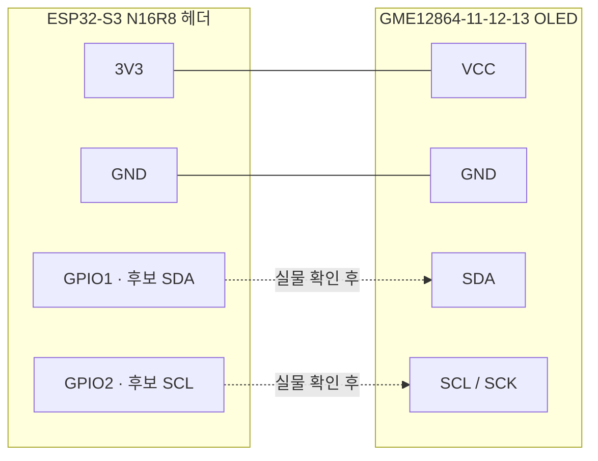
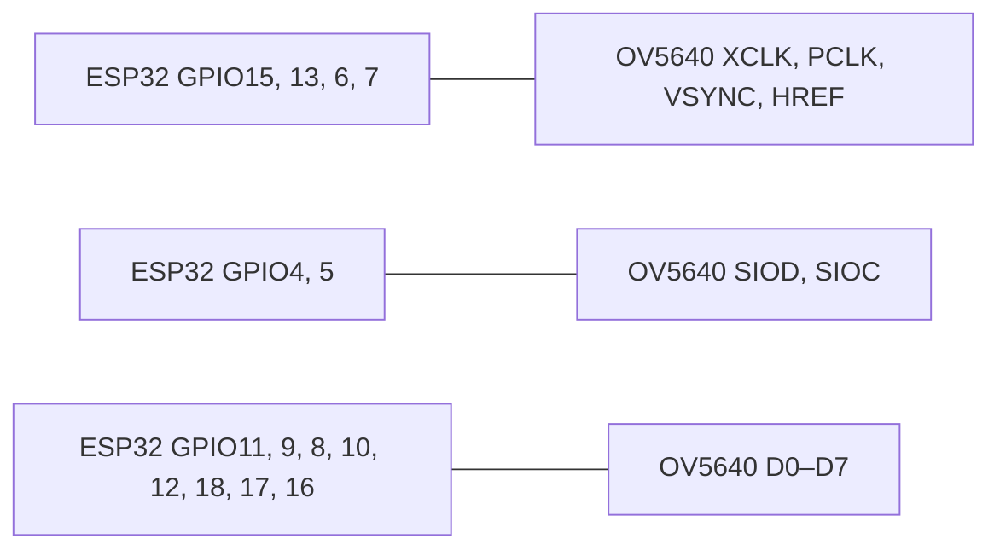
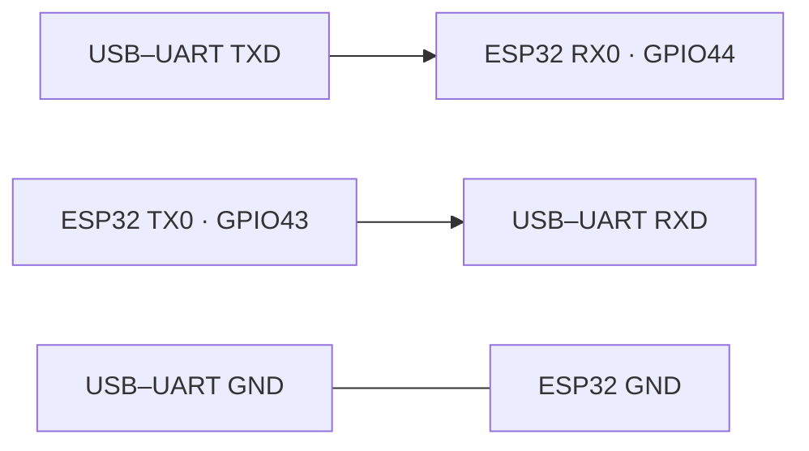

# WorkbenchCam

ESP32-S3가 만든 Wi‑Fi에 Android 휴대폰을 직접 연결해 작업대 영상을 보는 카메라입니다. GME12864-11-12-13 OLED에는 Wi‑Fi 이름, IP, 촬영과 냉각 상태를 표시합니다. V0.1.0 시험판은 320×240 MJPEG를 최대 5fps로 송출하며, 카메라 온도 실측 전에는 회당 60초 촬영 후 60초간 쉽니다.

카메라는 시청할 때만 시작합니다. 센서의 JPEG를 그대로 송출하고 XCLK 10MHz, 프레임 버퍼 한 개, CPU 160MHz로 구동합니다. ESP32의 AP는 접속을 위해 유지하며 송신 출력 상한은 15dBm입니다. OLED는 촬영 중에 밝아지고, 대기 중에는 밝기를 낮춥니다. UART의 종료 로그에서 전송 프레임 수와 촬영 시간을 확인할 수 있습니다.

## 준비물

- ESP32-S3 N16R8 보드와 기존에 장착한 OV5640 카메라
- GME12864-11-12-13 4핀 SSD1306 I²C OLED와 점퍼선 4개
- 보드의 USB UART 단자 또는 3.3V 로직 USB–UART 어댑터
- Android 10 이상 휴대폰

## 배선

전원을 끈 상태에서 OLED 기판의 실크 인쇄를 읽고 연결하세요. 보드마다 커넥터 위치와 인쇄 순서가 다르므로 기판의 실제 핀 이름을 기준으로 합니다.

### OLED 4핀

| OLED 표기 | ESP32-S3 쪽 | 확인 사항 |
| --- | --- | --- |
| `VCC`, `VDD` | `3V3` | OLED 전원과 I²C 풀업을 3.3V 기준으로 사용 |
| `GND` | `GND` | 공통 접지 |
| `SDA` | 가용 GPIO. 후보 `GPIO1` | 헤더에 노출되어 있고 다른 기능에 연결되지 않았는지 확인 |
| `SCL`, `SCK` | 가용 GPIO. 후보 `GPIO2` | 헤더에 노출되어 있고 다른 기능에 연결되지 않았는지 확인 |



GPIO1과 GPIO2는 기존 OV5640 핀맵에서 사용하지 않으며 Espressif DevKitC-1 헤더에 노출된 후보입니다. 현재 보드에서도 두 핀이 노출되고 비어 있는지 확인되면 `config.local.h`에서 `OLED_SDA_GPIO 1`, `OLED_SCL_GPIO 2`로 지정합니다. 다른 핀을 사용하면 해당 번호로 바꿉니다. 펌웨어는 `0x3C`와 `0x3D`를 확인하고 응답한 주소를 UART에 출력합니다. [OLED 제조사 사양](https://goldenmorninglcd.com/oled-display-module/0.96-inch-128x64-ssd1306-gme12864-11/), [Espressif DevKitC-1 헤더](https://docs.espressif.com/projects/esp-idf/en/v5.2/esp32s3/hw-reference/esp32s3/user-guide-devkitc-1.html)

### 기존 카메라

이미 장착된 카메라는 그대로 사용합니다. 아래 표는 기존 보드 프로필의 **ESP32 GPIO 번호와 카메라 신호**를 연결합니다. 카메라 커넥터의 접점 번호, 전원 핀, 리본 방향은 보드 또는 모듈 회로도를 기준으로 확인합니다.

| 신호 | ESP32 GPIO | 신호 | ESP32 GPIO |
| --- | --- | --- | --- |
| XCLK | 15 | PCLK | 13 |
| SIOD / SCCB SDA | 4 | SIOC / SCCB SCL | 5 |
| VSYNC | 6 | HREF | 7 |
| D0 / Y2 | 11 | D1 / Y3 | 9 |
| D2 / Y4 | 8 | D3 / Y5 | 10 |
| D4 / Y6 | 12 | D5 / Y7 | 18 |
| D6 / Y8 | 17 | D7 / Y9 | 16 |
| PWDN | 미할당 | RESET | 미할당 |



[기존 OV5640 핀맵](https://github.com/kjsu1994/ESP32-S3/blob/master/include/boards/esp32s3_camera_ov5640.h), [이 프로젝트의 핀 정의](firmware/include/board_pins.h)

### UART 업로드

보드에 USB UART 단자가 있으면 해당 단자와 PC를 USB 케이블로 연결합니다. 외장 USB–UART를 쓸 경우 3.3V 로직의 TX/RX를 교차 연결하고 GND를 공유합니다. 보드에 별도로 전원을 공급하는 경우 어댑터의 전원 핀은 비워 둡니다.



자동 다운로드 진입이 되지 않으면 BOOT을 누른 채 RESET을 눌렀다 놓고 BOOT을 놓습니다. `COM9`는 초기 개발 PC에서 확인한 포트이며, 다른 PC에서는 장치 관리자에서 포트를 확인합니다. [Espressif 부트 모드 및 자동 리셋](https://docs.espressif.com/projects/esptool/en/latest/esp32s3/advanced-topics/boot-mode-selection.html)

## 펌웨어 올리기

PlatformIO를 설치하고, 예제 설정을 복사한 뒤 `CAMERA_AP_PASSWORD`에 8–63자의 고유한 ASCII 비밀번호를 입력합니다. OLED가 연결되면 확인한 핀 번호도 입력합니다. 설정 파일은 Git에서 제외됩니다.

```powershell
Copy-Item firmware/include/config.example.h firmware/include/config.local.h
pio run -d firmware
pio run -d firmware -t upload --upload-port COM9
pio device monitor -d firmware --port COM9
```

UART 속도는 115200이며 초기 상태에서 `[Wi-Fi] WorkbenchCam at 192.168.4.1`을 확인합니다. 첫 영상 요청 때 센서 PID `0x5640`과 PSRAM 용량이 출력되며, 종료하면 소프트웨어 대기 명령과 카메라 종료 결과가 출력됩니다. 카메라와 전원부 표면 온도 및 XCLK 출력의 물리적 검증은 별도로 진행합니다.

## Android 앱

1. GitHub [릴리스](https://github.com/kjsu1994/esp32-s3-camera/releases)에서 APK를 받아 설치합니다.
2. **연결 및 보기**를 누르고 Wi-Fi 설정에 보드의 비밀번호를 입력합니다. **이 휴대폰에 저장**을 선택하면 Android Keystore로 암호화해 보관합니다. 상단 **설정**에서 다시 바꿀 수 있습니다.
3. Android의 Wi‑Fi 연결 요청을 승인합니다. Android 10–12는 연결 요청에 위치 권한이 필요할 수 있고, Android 13 이상은 근처 기기 권한을 사용합니다.
4. **사진 저장**을 누르면 현재 프레임이 갤러리의 `Pictures/WorkbenchCam`에 저장됩니다.

세로 화면에서는 영상과 조작 버튼을 위아래로, 넓은 가로 화면에서는 좌우로 배치합니다. 상태와 남은 시간은 영상 밖에 표시합니다. 앱은 보드 연결 인터페이스를 통해 `GET http://192.168.4.1/status`와 `GET http://192.168.4.1:81/stream`을 호출합니다. 촬영이 끝나면 다시 보기 전에 냉각 시간이 적용됩니다.

### 앱에서 보드 제어

연결 상태에서 **설정 → 보드 설정**을 열면 다음 항목을 바꿀 수 있습니다. 설정은 보드에 저장되어 재부팅 후에도 유지됩니다.

| 설정 | 동작 |
| --- | --- |
| 전송 절전 | 다음 시청의 최대 프레임률을 5fps에서 3fps로 낮춰 전송량을 줄입니다. |
| 180° 회전 | 다음 시청부터 카메라 모듈에서 가로와 세로를 뒤집습니다. |
| OLED 밝기 항상 낮게 | 연결된 OLED의 밝기를 촬영 중에도 낮게 유지합니다. |
| 정지 | 앱의 정지 버튼이 보드에 종료를 요청합니다. 종료 후 냉각 시간이 적용됩니다. |

보드는 `GET /settings`와 `POST /settings`를 통해 세 옵션을 JSON으로 읽고 저장합니다. `POST /stop`은 진행 중인 촬영을 끝냅니다. 두 POST는 보드 Wi-Fi에서 `Content-Type: application/json`을 요구합니다. HTTP 트래픽은 비밀번호가 설정된 보드 Wi‑Fi 안에서 전송됩니다.

### 앱 소스에서 빌드

JDK 17과 Android SDK 36이 필요합니다.

```powershell
Set-Location android
.\gradlew.bat testDebugUnitTest lintDebug assembleRelease
```

릴리스에 배포할 APK는 `app/build/outputs/apk/release/`의 unsigned APK를 `zipalign`한 뒤 `apksigner`로 서명합니다. 향후 같은 설치본을 업데이트하려면 최초 APK와 같은 서명 키로 서명합니다. [Android 앱 서명](https://developer.android.com/studio/publish/app-signing)
